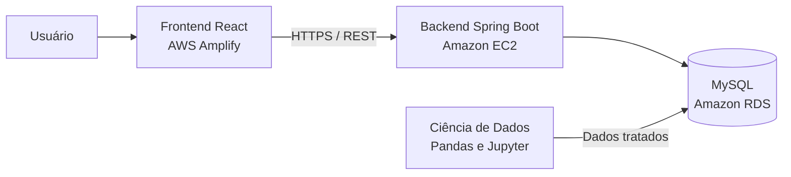

# PI Datacenter Sustentável

Projeto integrador voltado ao monitoramento de um datacenter, reunindo uma dashboard web, uma API para consulta dos indicadores e um processo de Ciência de Dados para tratamento das medições de consumo e sustentabilidade.

O projeto acompanha informações como consumo energético, utilização de GPUs, refrigeração, consumo e reaproveitamento de água, eficiência energética, eficiência hídrica, turnos e zonas de processamento.

## Visão geral

O sistema foi dividido em três módulos independentes:

- **Frontend:** dashboard React para visualização dos indicadores, infraestrutura, alertas, energia e relatórios.
- **Backend:** API REST em Java e Spring Boot responsável pela consulta dos dados armazenados no MySQL.
- **Ciência de Dados:** notebook e bases utilizadas para exploração, limpeza, padronização e preparação dos dados.

## Arquitetura planejada



| Camada | Tecnologia | Hospedagem planejada |
|---|---|---|
| Interface | React, Vite e React Router | AWS Amplify Hosting |
| API | Java 21 e Spring Boot | Amazon EC2 |
| Banco de dados | MySQL | Amazon RDS |
| Tratamento de dados | Python, Pandas e Jupyter | Execução local/Google Colab |

## Estrutura do repositório

```text
pi-datacenter/
├── frontend/             # Dashboard React
├── backend/              # API Java com Spring Boot
├── ciencia-de-dados/     # Notebook, bases CSV e script SQL
└── README.md
```

Cada módulo possui seu próprio README com instruções específicas:

- [Documentação do frontend](frontend/README.md)
- [Documentação do backend](backend/README.md)
- [Documentação de Ciência de Dados](ciencia-de-dados/README.md)

## Funcionalidades da dashboard

- Página de login demonstrativa.
- Visão geral do centro de operações.
- Indicadores de disponibilidade, consumo e temperatura.
- Visualização de servidores e racks.
- Central de alertas operacionais.
- Indicadores de energia e ambiente.
- Relatórios e inventário da infraestrutura.
- Configuração do endereço da API.
- Layout responsivo para computador, tablet e celular.
- Modo de demonstração enquanto o backend não estiver publicado.

## Executar o frontend

### Requisitos

- Node.js 20 ou superior.
- npm.

### Inicialização

```bash
cd frontend
npm install
npm run dev
```

Para utilizar os dados reais, crie `frontend/.env` com:

```env
VITE_API_URL=http://localhost:8080/api
VITE_USE_MOCK=false
```

Para gerar os arquivos de produção:

```bash
npm run build
```

O resultado será criado em `frontend/dist/`.

## Executar o backend

### Requisitos

- Java 21.
- MySQL.

O backend utiliza variáveis de ambiente para evitar credenciais dentro do código:

```text
DB_URL
DB_USERNAME
DB_PASSWORD
JPA_SHOW_SQL
```

Exemplo no PowerShell:

```powershell
cd backend
$env:DB_URL="jdbc:mysql://localhost:3306/datacenter_ia"
$env:DB_USERNAME="root"
$env:DB_PASSWORD="sua_senha"
.\mvnw.cmd spring-boot:run
```

### Endpoints disponíveis

| Método | Endpoint | Descrição |
|---|---|---|
| `GET` | `/api/dashboard/resumo-diario` | Resumo diário dos indicadores |
| `GET` | `/api/medicoes/{id}` | Consulta uma medição pelo identificador |
| `GET` | `/api/parametros-sustentabilidade` | Lista os parâmetros de sustentabilidade |
| `GET` | `/api/status-eficiencia` | Lista os estados de eficiência |
| `GET` | `/api/turnos` | Lista os turnos cadastrados |
| `GET` | `/api/zonas` | Lista as zonas e clusters |

## Ciência de Dados

A pasta `ciencia-de-dados/` contém:

- Base original com 5.000 registros.
- Base tratada com 5.000 registros.
- Notebook com o passo a passo da limpeza.
- Script SQL com a estrutura e os dados do banco.
- Arquivo `requirements.txt` para reprodução do ambiente.

Para executar o notebook localmente:

```powershell
cd ciencia-de-dados
python -m venv .venv
.\.venv\Scripts\Activate.ps1
pip install -r requirements.txt
jupyter notebook
```

O tratamento realiza preenchimento de valores ausentes, correção de números inválidos, padronização de categorias, validação dos percentuais e remoção de colunas técnicas.

> O script SQL começa com `DROP DATABASE IF EXISTS datacenter_ia`. Ele deve ser revisado antes da execução e não deve ser aplicado diretamente em um banco de produção.

## Integração entre frontend e backend

O frontend possui uma camada de comunicação centralizada em `frontend/src/services/api.js`. Atualmente, ele também oferece dados simulados para demonstração.

Para concluir a integração com os dados reais, será necessário:

1. Publicar a API na EC2.
2. Configurar as variáveis do banco na instância.
3. Ajustar a camada `api.js` aos endpoints e formatos retornados pelo backend.
4. Definir `VITE_API_URL` no AWS Amplify.
5. Alterar `VITE_USE_MOCK` para `false`.
6. Liberar no CORS somente o domínio definitivo do frontend.
7. Disponibilizar a API por HTTPS para evitar bloqueio de conteúdo misto no navegador.

## Publicação na AWS

### Frontend — AWS Amplify

Ao conectar este repositório ao Amplify, selecione a opção de monorepositório e utilize:

```text
App root: frontend
Build command: npm run build
Build output directory: dist
```

### Backend — Amazon EC2

O backend pode ser empacotado com:

```powershell
cd backend
.\mvnw.cmd clean package
```

O arquivo executável será criado em `backend/target/` e poderá ser iniciado na EC2 com Java 21.

## Segurança

- Nenhuma senha real deve ser adicionada ao repositório.
- Arquivos `.env`, ambientes virtuais, `node_modules` e `target` são ignorados pelo Git.
- As credenciais do banco devem ser configuradas diretamente no ambiente da EC2.
- A porta do banco deve aceitar conexões somente do grupo de segurança da aplicação.
- O CORS deve permitir apenas os domínios necessários.
- O acesso público à API deve utilizar HTTPS.

## Situação atual

| Componente | Situação |
|---|---|
| Dashboard React | Concluída em modo demonstrativo |
| API Spring Boot | Implementada e compilando corretamente |
| Tratamento dos dados | Documentado e concluído |
| Banco MySQL | Script de criação disponível |
| Integração frontend/API | Pendente de adequação dos contratos |
| Publicação na AWS | Pendente |

## Uso acadêmico

Este repositório foi desenvolvido para fins educacionais como parte de um projeto integrador. Os dados e indicadores devem ser revisados antes de qualquer uso em ambiente produtivo.
